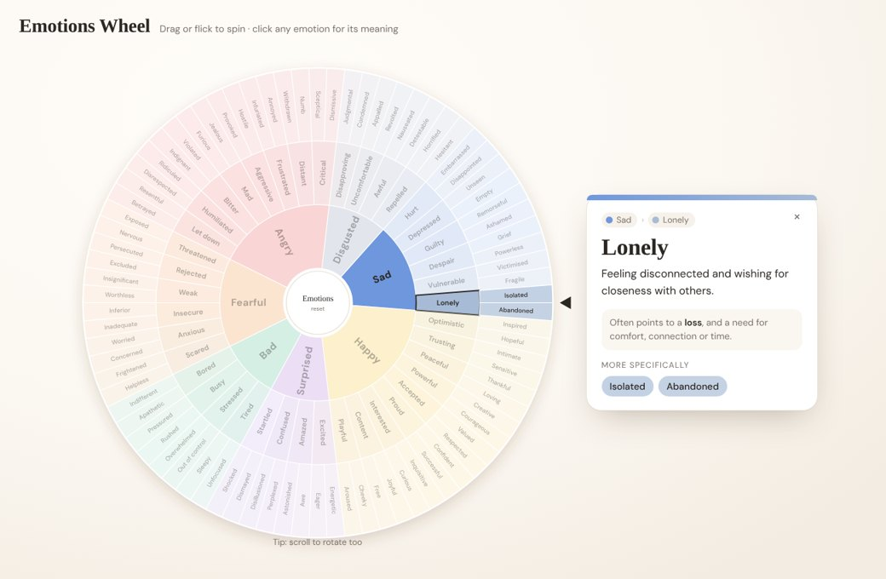

# Emotions Wheel

An interactive emotions wheel that you can spin, click and explore. Click any emotion and a card pops up with a short definition, the broader emotion it belongs to, and related words.



**▶ Try it:** https://lanalikescode.github.io/emotionswheel/

---

## What it does

- **Three rings.** The centre holds 7 core emotions (Happy, Sad, Angry, Fearful, Surprised, Disgusted, Bad). Moving outward, the words get more specific: 41 in the middle ring and 82 on the outside.
- **Spin it.** Drag it around with your mouse or finger, give it a flick, or scroll. On a keyboard, use the ← → arrow keys.
- **Click an emotion.** The wheel turns that emotion to the pointer and a card pops up with:
  - what it means
  - where it sits on the wheel, e.g. *Sad › Lonely*
  - what that kind of emotion often signals
  - buttons for more specific (or nearby) emotions
- **Click the centre** to put the wheel back where it started. Press **Esc** to close the card.
- It works on phones, tablets and computers.
- It's drawn with SVG (vector graphics), so it stays sharp at any size.

---

## Use it on your own computer (no installing anything)

1. On this page, click the green **Code** button, then **Download ZIP**.
2. Unzip the file you downloaded.
3. Double-click **`index.html`**. The wheel opens in your web browser.

It works offline too. Only the fancy fonts need internet; without it the page uses your computer's usual fonts.

---

## Change the words, definitions or colours

Everything the wheel *says* lives in one file: **`emotions.js`**. You don't need to touch any other file.

It looks like this:

```js
{
  name: "Sad",
  color: "#6E97DE",
  definition: "Feeling low, heavy or sorrowful, often after a loss or disappointment.",
  whatItMayMean: "Often points to a <b>loss</b>, and a need for comfort, connection or time.",
  more: [
    { name: "Lonely", definition: "Feeling disconnected and wishing for closeness with others.", more: [
      { name: "Isolated", definition: "Feeling cut off from people or support." },
      { name: "Abandoned", definition: "Feeling left behind by someone you relied on." }
    ]},
    ...
```

- **`name`** is the word shown on the wheel.
- **`definition`** is the text that shows up in the popup card.
- **`color`** sets the colour of the whole slice (core emotions only). The middle and outer rings get lighter shades of it automatically. To find a colour code, use a picker such as [htmlcolorcodes.com](https://htmlcolorcodes.com).
- **`whatItMayMean`** is the grey note in the popup (core emotions only).
- **`more`** lists the more specific emotions one ring further out.

### Option A: edit straight on GitHub (easiest)

1. Click **`emotions.js`** in the file list above.
2. Click the ✏️ pencil icon (top right of the file).
3. Make your change.
4. Click **Commit changes…** and then **Commit changes** again.
5. Wait about a minute. GitHub checks your edit automatically:
   - A green **✓** next to your change means it's fine. The live site updates within a minute or two.
   - A red **✗** means something's off. Click it and then **Details** to see what to fix.

### Option B: edit on your computer

1. Open `emotions.js` in any text editor (Notepad, TextEdit, or [VS Code](https://code.visualstudio.com/)).
2. Save, then refresh `index.html` in your browser.
3. If the wheel goes blank, open **`check.html`**. It tells you what's wrong in plain language.

### Common mistakes

| Problem | Fix |
|---|---|
| Wheel is empty | Usually a missing **comma** between two `{ ... }` blocks, or a missing `"`. Open `check.html`. |
| A word is cut off | Shorten it. Outer-ring words fit best at about 14 letters or fewer. |
| Quote marks inside a definition | Use a curly ’ or “ ” inside the text instead of a plain `"`. |

---

## Put it on your own website

**Simplest:** paste this where you want the wheel to appear (it hides the title so only the wheel shows):

```html
<iframe src="https://lanalikescode.github.io/emotionswheel/?embed"
        style="width:100%; height:820px; border:0" title="Emotions Wheel"></iframe>
```

**Or host the files yourself:** copy `index.html`, `style.css`, `script.js` and `emotions.js` into the same folder on your site.

---

## What's in this folder

| File | What it is |
|---|---|
| `index.html` | The page itself. Open this. |
| `emotions.js` | ✏️ **The words, definitions and colours.** This is the file to edit. |
| `check.html` | Open this to check your edits for mistakes. |
| `script.js` | Draws the wheel, makes it spin, shows the popup. |
| `style.css` | How everything looks: fonts, spacing, the popup card. |
| `checks.js` | The rules `check.html` and the automatic GitHub check use. |
| `tests/run-checks.js` | Runs those checks from the command line (`npm test`). |
| `.github/workflows/` | Makes GitHub run the checks and publish the live site automatically. |

---

## For developers

No build step and no dependencies: it's plain HTML, CSS and JavaScript.

```bash
npm test         # validate emotions.js (Node 18+)
npm start        # serve locally at http://localhost:3000 (optional; opening index.html directly also works)
```

How the colours work: each slice is the core colour, blended slightly toward its neighbour near the edges, and then lightened for the middle (28%) and outer (52%) rings. See `script.js` if you want to change that.

### Credits

The three-ring layout follows the widely used feelings wheel (Dr Gloria Willcox, 1982), in the arrangement popularised by Geoffrey Roberts. The definitions in this project are written from scratch.
